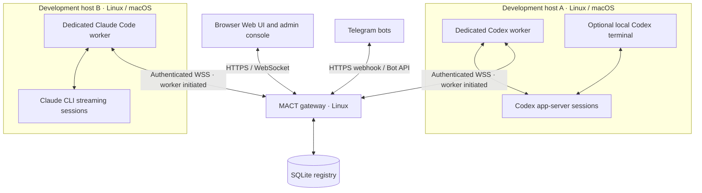

# MACT — Multi Agent Control Tower

Control Codex and Claude Code sessions across machines from a responsive Web UI
or Telegram. A Go gateway connects dedicated workers over authenticated outbound
WSS; sessions keep running when a browser or gateway connection closes.

## Installation

Requires curl and `sha256sum` or `shasum`. Have a domain and Telegram bot details
ready for the gateway. Enroll each worker in the gateway admin console and run
its installer as the project owner, without sudo. Install Claude Code first;
use its existing login or configure API credentials in MACT.

**Gateway — Linux with systemd:**

```sh
curl -fsSL https://raw.githubusercontent.com/arizzi74/MACT/main/scripts/install.sh | sudo sh -s -- setup gateway
```

**Codex worker — Linux with systemd or macOS:**

```sh
curl -fsSL https://raw.githubusercontent.com/arizzi74/MACT/main/scripts/install.sh | sh -s -- setup worker
```

**Claude Code worker — Linux with systemd or macOS:**

```sh
curl -fsSL https://raw.githubusercontent.com/arizzi74/MACT/main/scripts/install.sh | sh -s -- setup claude-worker
```

Setup installs the latest stable MACT release. The HTTPS bootstrap checks a
pinned native manager; that manager verifies signed release provenance and
downloaded packages. An [optional authenticated-first procedure](docs/installation.md#download-and-authenticate-the-installer)
is also available.

See the [installation guide](docs/installation.md),
[Claude setup](docs/claude-code.md), and [detailed overview](docs/overview.md).

## Architecture

Workers can share a host or run on separate Linux/macOS machines. Each provider
uses its own worker identity, service and state; supported features differ.


