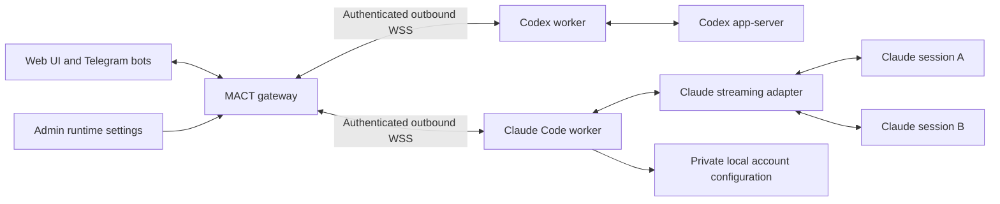

# Claude Code workers

MACT supports Claude Code through a dedicated `claude-worker` service. One
Claude worker manages one local Claude installation and account configuration;
it can run multiple independent sessions. Codex continues to use `codex-worker`.
Both workers can coexist on a host with separate enrollment identities, services,
configuration, state and update queues.



The Go adapter launches the installed Claude CLI directly, using its streaming
JSON input, output and permission control protocol. It does not evaluate a shell
wrapper. Claude owns native conversation persistence; the worker maintains a
private session inventory and display history. This release lists sessions
created through the Claude worker; it does not import unrelated existing CLI
sessions automatically.

## Install

Install and sign in to Claude Code using its
[official installation instructions](https://code.claude.com/docs/en/setup).
Alternatively, configure an API key or authentication token in MACT after
worker enrollment. Claude must already be installed for the worker's OS account.
MACT uses an existing Claude CLI installation. After setup, it checks the configured official
release channel daily and updates supported native installations when the worker is idle.

In the gateway admin console choose **Enroll worker**, then on the worker host:

```sh
curl -fsSL https://raw.githubusercontent.com/arizzi74/MACT/main/scripts/install.sh | sh -s -- setup claude-worker
```

Setup installs the latest stable MACT release. See the
[installation guide](installation.md) for requirements and the
[optional authenticated-first procedure](installation.md#download-and-authenticate-the-installer).

On an existing MACT installation:

```sh
mact setup claude-worker
```

Enter the worker name and the one-use enrollment URL. Linux setup asks whether
to restrict the service. Service restrictions and Claude's tool permission mode
are separate: selecting a Claude permission mode never grants operating-system
privileges. Linux uses `claude-worker.service`; macOS uses
`com.iaia.claude-worker` as the logged-in user's LaunchAgent.

Paths are relative to the worker service account's home:

| Purpose | Path |
| --- | --- |
| Worker configuration | `~/.config/claude-worker/config.json` |
| Worker state | `~/.local/state/claude-worker/` |
| Runtime account settings | `~/.local/state/claude-worker/runtime-settings.json` |
| Worker executable | `~/.local/bin/claude-worker` |

The account settings file is optional until first saved through the admin
console. Its permissions must be `0600` or stricter. Native Claude login files
remain under the installed CLI's normal configuration directory.

## Configure the worker account

Expand **Workers** in the admin console, select the Claude worker's runtime
configuration button, and set:

- **Model:** the Claude model alias or custom endpoint's model identifier.
  The chosen model also populates the Opus, Sonnet and Haiku model aliases.
- **API endpoint:** leave empty for Claude's normal endpoint, or provide the
  compatible endpoint used by your account.
- **Authentication:** existing Claude login, API key (`ANTHROPIC_API_KEY`), or
  authentication token (`ANTHROPIC_AUTH_TOKEN`).
- **Permissions:** normal approval requests, accept edits, plan mode, or an
  explicit bypass-permissions choice.

The credential is write-only in the UI. An omitted credential preserves the
existing value; **Remove saved credential** clears it. Switching to existing
login stops passing the saved key/token to Claude, even if it is retained for
later use. An active API-key or token mode requires a nonempty credential.

Configuration requests use the authenticated live worker connection. The gateway
does not persist credentials in its database, command queue or event history.
The worker writes them atomically to the private settings file. Offline workers
cannot be configured, and interrupted saves are never automatically replayed.
Refresh the settings to check their state before retrying.

Changes require all worker sessions and queues to be idle, including outstanding
approval requests. Idle Claude processes are retired after a successful save;
the next message resumes the native session using the new settings. Existing
conversation context is retained when you change account or model.

## Session behavior

Use **+** beside the worker to create a session with a project path, then use
Telegram or the Web UI to send messages. Live assistant text, tool calls/results,
approvals and clarification questions use MACT's existing session routing.
File uploads and downloads retain the worker workspace restrictions.

New Claude sessions in the Web UI default to `~/CLAUDE_CODE/<session_name>`
on the worker, with spaces in the session name replaced by underscores. You can
edit the path before creating the session.

Interactive enrollment permits the worker account's home and its subfolders,
including `~/CLAUDE_CODE`. For a manual installation using
`examples/claude-worker.json`, create `~/CLAUDE_CODE` first and replace the example
account path. Its default workspace root and runtime directory both use that
folder.

Existing configurations retain their explicit `allowed_workspace_roots` and
runtime directories during setup and updates. If a Claude worker is restricted
to `~/CODEX` or another custom folder, either choose a permitted project path
when creating a session or explicitly add `~/CLAUDE_CODE` to that worker's
allowed roots. Changing the suggested path does not grant additional filesystem
access or move existing projects.

A follow-up sent during a Claude turn is **queued** for a separate successor
turn. It does not change the current turn's instructions. The browser labels the
button **Queue**; Telegram's active-turn messages follow the same queue behavior.
A worker restart never silently replays uncertain prompts. Pending bridge queue
items are cancelled with a saved history notice so they can be resent explicitly.

Claude background agents and commands remain part of the request that launched
them, including agents that Claude starts in the background implicitly. MACT
keeps the turn active while that work runs and while the parent assembles its
final response. Interim replies and task updates stay in the same conversation;
queued input starts after the request finishes. Account changes and maintenance
remain blocked during this work. **Stop** cancels the turn and retires its Claude
process group before another message can start. Ambient housekeeping does not
keep a request active. A deliberately persistent background command keeps its
request active until it ends or you stop it.

This first integration does not provide Claude project archive/restore,
Codex goals, Codex quotas/reset redemption, native Codex terminal
attachment, or Codex-specific settings and plugins. These capabilities are not
advertised for Claude workers. Session naming changes only the name displayed in
MACT and Telegram.

### Delete a session

Choose **Edit session → Delete** and confirm the selected session. Deletion
requires an idle session with no queued messages, pending approvals or questions.
The worker removes that session's native transcript and session-specific files
under `~/.claude/projects/` (or the configured `CLAUDE_CONFIG_DIR/projects/`),
including its subagent transcripts and saved tool results. Other sessions and
shared project memory are preserved.

MACT also removes the worker's cached conversation, question and upload records,
and clears stored command content for the session. Minimal deletion markers and
command receipts remain so a restart or repeated request cannot restore the
deleted session. Already queued delivery events retain their original contents
until the gateway acknowledges them, then the worker removes them normally.

The project directory and every file in it are kept, including directories under
`~/CLAUDE_CODE/` and any custom project path. This action does not archive or
delete the project.

### Recover missed native output

For a turn completed prematurely by an older worker, an administrator can call
`thread/history/recover` on the worker's private local runtime socket after
initialization, supplying the existing `threadId` and `turnId`:

```json
{"id":2,"method":"thread/history/recover","params":{"threadId":"SESSION_UUID","turnId":"TURN_UUID"}}
```

Recovery requires a completed saved turn, its recorded native location, and no
open native process, active or queued input, pending approvals, or deletion.
After confirming sessions are idle, restarting the worker closes idle native
processes. Recovery reads the matching main native transcript without starting
Claude or submitting a prompt. It preserves the saved turn and existing item
identities, imports missed parent replies, tool calls and parent-visible task
completion summaries, and retains native message timestamps. Child transcripts
and private reasoning are excluded. Repeating a successful recovery adds no
duplicates. Ambiguous or changing sources leave saved history untouched.

The repaired turn ends at the final native reply. When the additional activity
has no trustworthy cumulative cost result, consumption is shown as unknown.
Refresh an open conversation to load the repaired history.

## Status line and account credit

Claude sessions show the model, actual Claude permission mode, turn activity,
current context, and cumulative session consumption in USD. Context and cost
appear when the CLI reports them; an unknown value is shown as a dash rather
than zero. The last turn's reported cost is available in the session cost
indicator's tooltip. `/status` reports the same observations in text.

The CLI's USD figure is a reported estimate, not a provider invoice. Custom
endpoints can bill at different rates. Session cost is retained across worker
restarts, and cumulative CLI totals are not added repeatedly. Historical costs
that were never reported to MACT remain unavailable until the native CLI
reports them; a crashed process can leave unreported spending unknown.
If a native counter resets below its saved total, MACT marks session cost as
unavailable instead of presenting the old subtotal as current spending.

For `https://api.abliteration.ai`, the worker also reads the documented
[`GET /v1/credits`](https://docs.abliteration.ai/api-reference/credits/get-the-credit-balance-for-the-api-keys-organization)
endpoint using its configured API credential. It displays remaining USD credit
as `max(0, total_credits - total_usage)`. This is an account-wide balance, including
usage outside this session. It refreshes on worker startup and approximately
every 60 seconds; the tooltip shows the check time. Finalized usage can lag an
active turn.

The provider request runs on the worker. Credentials and raw billing responses
are never sent to the browser or gateway. Account changes clear the old balance,
and an in-flight response from the old account is discarded. Failed checks show
an unavailable value. Other providers show no invented account balance.

## Maintenance

```sh
claude-worker status
claude-worker doctor
mact update claude-worker
mact update claude --check
mact update claude
```

Worker updates use the normal signed MACT release and idle checks. They do not
invoke the Codex runtime updater or overwrite another worker's service or state.
Claude worker maintenance also checks the official Claude Code release channel
once per UTC day. The default channel is `latest`; an installation that explicitly
selects `stable` retains that choice. Pending runtime updates and restarts are retried at every maintenance
tick until all turns, queues, approvals and background work are idle. The worker's
private update lease blocks new work throughout installation and readiness checks.
The Web UI worker update action and `/tgupdateworkers` perform a fresh runtime
check even when the worker binary is current, and report worker and Claude runtime
outcomes separately. Their discovery result is retained across idle retries and
updater restarts without changing the automatic daily schedule.

`mact update claude` runs only runtime maintenance under the Claude worker's own
installation lock; `--check` inspects versions without installing or changing
update state. Supported native installations use Claude Code's official configured
release channel. npm, package-manager, wrapper, custom or otherwise unrecognized
installations remain externally managed and are reported without modification.
Failed validation restores the previous launcher and withholds the rejected
release. Runtime replacement preserves configuration, credentials, workspaces
and native conversation data. Claude and Codex maintenance keep separate state,
recovery journals, services and runtime reports. Interrupted Claude runtime
recovery finishes before another worker release can replace the worker binary;
normal updates resume on the following maintenance tick.

MACT keeps three private copies of previous Claude executables for recovery.
Retention removes only old native version files that MACT created and whose
contents still match its recorded hash. Independently installed or changed files
are preserved, along with global configuration, credentials, projects and
conversations.
