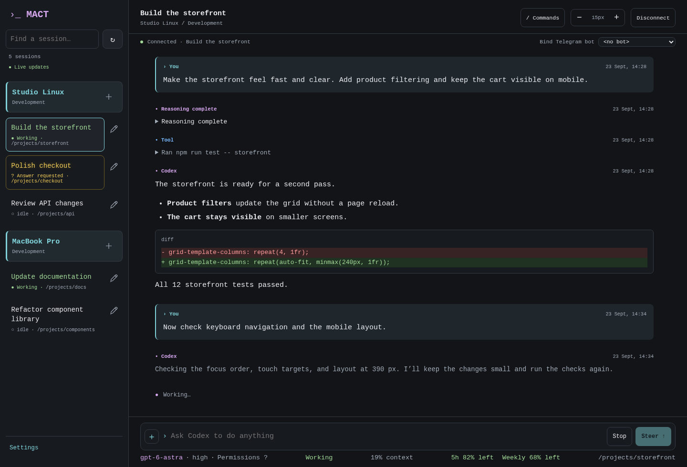
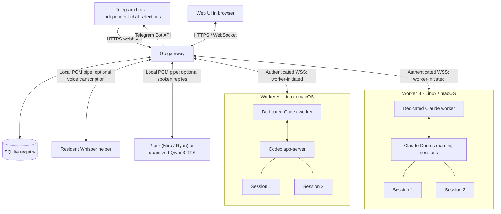

# MACT overview

[Project home](../README.md) · [Installation](installation.md) · [Claude Code workers](claude-code.md)

A control hub for coding agents across sessions and machines. MACT currently
supports Codex and Claude Code through dedicated workers, with access through a responsive browser interface and allowlisted
Telegram bots. Its Go gateway and Linux/macOS workers use embedded SQLite storage.
The gateway includes an admin console with passkeys and optional username/password
sign-in. Workers supervise
private Codex app-server processes or Claude Code streaming sessions. Codex workers also support local terminal attachment. See [Claude Code workers](claude-code.md) for setup and supported capabilities.

MACT was previously named Codex Telegram Gateway. The migration keeps existing
installations, sessions and commands working. The management command is now
`mact`; `codex-telegramgw` remains supported. See the
[name migration guide](mact-migration.md) for repository transition details
and compatibility guarantees.

The admin console can connect additional Telegram bots by token or create them
through Telegram's Managed Bots flow. Bots share the gateway owner's access and
worker inventory while keeping independent chat selections. See
[Telegram bot management](admin.md).

The browser interface displays Markdown and Mermaid diagrams on desktop and
mobile, with local rendering, zoom controls and access to the diagram source.
It also accepts images up to 10 MiB and other file attachments up to 20 MiB.
Other files are saved in the selected session's `inbound/` folder, with optional
instructions sent to the selected coding agent. See [Web UI file uploads](webui.md#uploading-files).

[Explore the website](https://arizzi74.github.io/MACT/) ·
[Installation guide](installation.md) ·
[Latest release](https://github.com/arizzi74/MACT/releases/latest)

[](https://arizzi74.github.io/MACT/#screenshots)

## Architecture

One gateway connects Telegram and the web UI to sessions on multiple machines.
Each worker opens an authenticated outbound WSS connection to the gateway;
commands and events travel over that connection.



## Quick install

Requires curl and `sha256sum` or `shasum`. Downloads are verified native Go
binaries; Python and a Go compiler are not required. Installing Codex when it
is missing also needs the standard `tar` and `gzip` utilities.

**Gateway (Linux with systemd):** run on the gateway machine:

```sh
curl -fsSL https://raw.githubusercontent.com/arizzi74/MACT/main/scripts/install.sh | sudo sh
```

Have a domain pointing to this machine, your Telegram bot username and token,
and your numeric Telegram user ID ready. The wizard
creates the gateway, guides HTTPS setup, registers the bot menu and webhook, and
prints the admin address and first passkey enrollment token. If nginx is
installed, it lists existing HTTPS virtual hosts and lets you select one for
the gateway routes, preserving its existing website. You can instead install a
standalone Caddy proxy on Debian or Ubuntu, using port 443 or an alternative
such as 8443. The prompts explain which firewall ports and certificate settings
are needed. See [HTTPS setup](installation.md#finish-gateway-setup).

**Codex worker (Linux with systemd or macOS):** choose **Enroll worker** in the gateway
console and copy the one-use URL, then run on its machine as the account that
owns your projects, without sudo:

```sh
curl -fsSL https://raw.githubusercontent.com/arizzi74/MACT/main/scripts/install.sh | sh
```

Enter a worker display name and the enrollment URL, which is visible as you
paste or type it. On Linux, answer **Restrict this worker service?** before
enrollment: **yes** (the default) restricts the service; **no** uses full account
permissions. The URL expires after 10 minutes and can be redeemed once; opening
it in a browser does not consume
it. Setup retrieves the gateway address, worker ID and token automatically,
installs Codex if missing, and guides sign-in with device login over SSH. New
guided workers start in your home directory and can access all its subfolders.
The installer's local answer determines Linux service access. Restricted access
blocks privilege elevation such as `sudo apt update`; full access follows your
account's existing permissions and sudo rules without granting new privileges.
The admin dialog's service-access selection remains for older installers.
Setup attempts to enable background startup after logout, requesting sudo if
required. If this fails, it prints the command for an administrator; the worker
is installed but may stop after logout. On macOS, it runs while your desktop
account is logged in.

**Claude Code worker:** install the Claude CLI for the project owner's account,
then enroll a separate worker identity and run without sudo:

```sh
curl -fsSL https://raw.githubusercontent.com/arizzi74/MACT/main/scripts/install.sh | sh -s -- setup claude-worker
```

Use an existing Claude login or configure the model, endpoint, authentication
mode and tool permissions in the admin console. Claude supports existing login,
API keys and authentication tokens; its private account settings stay on the
worker. Tool permission modes include normal approval requests, accepting edits,
plan mode and an explicit bypass-permissions choice. MACT installs and updates
the dedicated worker, while the account owner maintains the Claude CLI. See
[Claude Code workers](claude-code.md).

Prompts work through the pipe; bot-token input is hidden and enrollment URLs are
visible. Rerunning the installer preserves existing configurations and running
sessions; prepared private JSON
configurations are also supported. Gateway completion can be resumed with
`sudo mact finish gateway`.

Gateway URLs all live under `/tgw`: `/tgw/admin/` for the console,
`/tgw/webui/` for the browser agent interface, `/tgw/api/v1/` for APIs,
and `/tgw/healthz` and `/tgw/readyz` for health checks.

The gateway and worker installers enable daily MACT updates from
[GitHub Releases](https://github.com/arizzi74/MACT/releases).
Codex workers also check for stable Codex runtime updates once per day (UTC).
Claude workers leave their installed Claude CLI unchanged.
Supported standalone installations update when the worker has no active or
queued work, then its app servers restart and their versions are verified.
Runtime updates test compatibility before restarting production and retain the
previous release for recovery if the candidate fails.
Use `/tgupdateworkers` in Telegram or the Web UI to check every worker and its
Codex runtime against the latest releases. Results include installed, running,
and available Codex versions. Updates wait until the worker has no active turns
or pending work. When both are current, no restart is needed. This explicit
check does not change the daily background schedule.
See the [installation guide](installation.md) for HTTPS setup, worker
enrollment, and manual updates.

## Components

- **Gateway:** receives Telegram updates, manages worker connections, and serves
  the admin console and browser agent interface, with passkeys and optional
  username/password authentication.
- **Registry:** stores routing, commands, events, approvals, and Telegram
  delivery state in a local SQLite file.
- **Codex worker:** supervises Codex app servers on a development machine and
  executes commands within configured workspace roots.
- **Claude Code worker:** manages independent Claude streaming sessions through
  one local CLI installation and account configuration, with its own enrollment,
  service, private settings and state. It can coexist with a Codex worker.
- **Local Codex helper:** opens a terminal interface against a private app-server
  socket or starts an independent local runtime.

## Browser interface

Open `/tgw/webui/` on your gateway's HTTPS address, sign in with your existing
admin passkey, and choose a worker session. The interface uses Codex-inspired
colors and formatting with responsive text, completed replies and live tool activity,
question and approval prompts, and the selected provider's supported controls.
Codex sessions use the worker's existing app-server, including model and reasoning
controls. Claude sessions use the dedicated worker's streaming adapter and
native CLI persistence; they do not gain Codex-only features.

Select a link to a generated project file to see its path, size and worker in a
dialog, then choose **Download** without leaving the conversation. Downloads
also work for saved messages and are limited to regular project files up to
128 MiB. See the [file download guide](webui.md#downloading-project-files).

Workers with no sessions still appear in the sidebar. Select a worker heading
to collapse or expand its session list; its session count and **＋** control stay
visible. Each browser remembers which worker groups are collapsed.

Use **＋** beside a worker to create a session: enter its name and edit the
suggested project path if needed. Codex suggests `~/CODEX/session_name`; Claude
suggests `~/CLAUDE_CODE/session_name`. Spaces in the name become underscores in
the suggested path; existing project directories can also be used. The selected
path must be inside that worker's configured allowed roots. Existing explicit
roots stay unchanged during updates; a suggested path does not grant access.

Use the pencil beside a session to rename its display title or delete its saved
conversation while keeping the project directory and its files. Claude deletion
removes the selected native transcript and session-specific sidecars, worker
conversation caches, and stored command content. Content-free deletion markers
and receipts prevent restoration after retries or restarts; already queued
delivery events are removed after acknowledgement. Sibling sessions and shared
project memory are preserved. See [Claude session deletion](claude-code.md#delete-a-session).

Codex workers also support archiving a conversation and project together.
Archives are stored on that worker in `~/CODEX_Archived`; optional project cleanup
runs only after the backup has been verified. Restore an archive from the
worker's **＋** dialog. Claude project archive/restore is unsupported. Renaming
never moves the project directory. See
[session editing and archives](webui.md#session-editing-and-archives).
Revoked workers and their sessions are hidden from the sidebar and Telegram
session pickers, while their records remain in the admin console. Use **Delete**
beside a revoked worker to permanently purge its gateway database records after
confirmation; its project files and native agent sessions stay on the worker.

Browser sign-in normally lasts eight hours. Choose **Trust this device for 30
days** when signing in with a passkey to stay signed in across app restarts until
a fixed expiry date. Renewing trust requires another passkey verification;
ordinary activity never extends it. Optional
username/password access is configured in the [admin console](admin.md#optional-username-and-password)
and works in both browser interfaces alongside passkeys. After
unlocking, the interface restores the selected session and reading position;
running work continues. Optional encrypted text-draft recovery retains a copy
for 30 minutes. The admin console lists device names, browser details, last
activity and expiry, and can sign out one device or all devices. Sensitive admin
changes still require a recent sign-in.
See [sign-in and recovery](webui.md#sign-in-and-recovery).

Claude's status line shows its model, actual tool permission mode, activity,
reported context and session cost. Unknown measurements appear as a dash. For a
configured Abliteration.ai account it also shows remaining account credit and
when it was checked; cost estimates and account credit are different values.
See [Claude status and account credit](claude-code.md#status-line-and-account-credit).

Connection progress distinguishes the live connection from session restoration
and history loading. On mobile, the session menu turns green while any session
is working; a pending question takes priority with a yellow question mark.

Open **Settings** at the bottom of the session sidebar to manage draft recovery
and notifications, or open the operations console. Enable notifications there
to receive turn-completion alerts from all sessions, including while the web app
is closed. On iPhone or iPad, first add the web UI to the Home Screen and open it
from there.

Disconnecting closes the viewer while accepted turns keep running. Reconnecting
loads current history without resending prompts. Drafts remain in browser memory
while the page stays open. See the [browser interface guide](webui.md) for
controls and limits, and the [route migration instructions](installation.md#upgrade-to-the-tgw-url-routes)
before updating an existing installation to `/tgw`.

## Configuration and startup

Use the [example configuration](../examples/) as a starting point. Set the gateway's
public HTTPS URL, SQLite `database_path`, and Telegram webhook secret
environment variable for your deployment. Configure each worker with its gateway
WebSocket URL, enrollment credential, state-file location, allowed workspaces,
and runtime profiles.

Create a private `.botsecrets` file containing `BOTNAME`, `BOTTOKEN`, `WLNAME`,
and `WLID`, then reference its location in the gateway configuration. Keep real
credentials and deployment configuration outside Git.

Run the gateway and worker with their respective configuration files:

```sh
codex-gateway --config /path/to/gateway.json serve
codex-worker --config /path/to/worker.json run
claude-worker --config /path/to/claude-worker.json run
```

The gateway creates its SQLite database at `database_path`; relative paths are
resolved against the configuration directory. Use a local disk and a private,
writable directory. It needs the webhook-secret environment variable named in
its configuration; no database server or database credentials are required.
Each worker needs a private enrollment-token file and its configured native CLI.
Use `codex-worker status` and `codex-worker doctor` for Codex, or
`claude-worker status` and `claude-worker doctor` for Claude. These diagnostics
inspect the worker and its runtime compatibility.
When using a custom configuration file, pass the same `--config` option to
diagnostics and terminal attachment commands.

Workers also use embedded SQLite at their configured `state_file`; no database
server, SQLite CLI, Python, or separate C library is required. Existing worker state is
converted automatically on startup, retaining a private `.bbolt-backup` of the
original. See [worker storage and recovery](operations.md#worker-storage-and-ambiguous-outcomes).

[Service and proxy templates](../deploy/) are provided for Linux systemd, macOS
launchd, and nginx. Customize their paths, service accounts, permissions, and
TLS settings before installing them. Choose worker permissions to match the
operations you authorize the selected agent to perform.

## Telegram commands

The bot authorizes only the numeric `WLID` in its private `.botsecrets` file.
Changing a Telegram username does not grant access. To use the bot, send
`/tgstart`, then `/tginstances` or `/tgsessions` and select a session.
Use `/tgsessions` to select a session or create one with **New session**.
Ordinary messages, images and enabled voice notes start a new turn when the
selected session is idle. During a Codex turn they steer that turn; during a
Claude turn they queue a separate successor turn without changing its current
instructions.
Gateway commands begin with `/tg`: `/tgstatus`, `/tgdeletesession`,
`/tglastmessages`, `/tghistory`, `/tgmultisession`, `/tgdisconnect`, `/tgsteer`,
`/tginterrupt`, `/tgquestions`, and `/tginput`. Telegram's initial
`/start` button remains an alias for `/tgstart`.

On Codex workers, unprefixed commands control Codex: `/status` shows the selected
session's running Codex version, model, reasoning, recorded context/token usage, remaining account
allowances and reset times; `/model`, `/compact`,
`/review`, `/fork`, `/rename`, and the other commands appear in the bot menu.
Use `/model` to choose a model with buttons, then choose its reasoning effort.
Use `/help` for Codex commands and `/tghelp` for gateway controls. Terminal-only
commands explain how to use the attached CLI. The bot shows “typing…” while
the selected agent is preparing a response and stops when a reply or an input
request arrives. Claude supports a smaller command set; `/status` reports its
model, permissions and observed usage rather than Codex quotas and controls.
See [Telegram commands](telegram-commands.md) for syntax and supported actions.

Use `/tghistory` to display the last two saved conversation messages in their
original order, with the newest last, including Telegram prompts, attached Codex
terminal prompts and agent replies. Set a count with `/tghistory 10` and use
**Older messages** to continue backwards. Each message has its saved date and time, with a
turn-time label when an exact message
time is unavailable. Reading history does not run the prompts again.
Use `/tglastmessages` for the last saved user or Codex message, or
`/tglastmessages 10` for the last ten messages displayed oldest first within
that recent window.

Send a photo or a JPEG, PNG, WebP or GIF image file to the selected session,
with an optional caption. Images can be up to 10 MiB; both the gateway and
worker must support image input (v0.5.13 or later).

Other files sent as Telegram documents, up to 20 MiB each, are saved in the
selected session's working directory under `inbound/`. Without a caption, the
bot confirms the saved path without contacting the agent. With a caption, the
caption and saved path become a prompt, steer an active Codex turn, or queue a
successor Claude turn. Filenames
receive a unique suffix to prevent overwriting existing files. See
[receiving files](telegram-commands.md#receiving-files).

Telegram voice notes can be transcribed locally with a bundled Whisper helper.
Open **Admin → Audio support in Telegram** to enable transcription, download a
model, and select CPU threads. The page shows available CPUs and RAM, recommends
the multilingual **base** model and one fewer thread than available cores
(minimum one), and preserves existing installations' selections. The CLI
alternative remains `sudo mact setup voice`.

Optional spoken replies offer **Piper (Miro / Ryan)** for Italian and English or
**Qwen3-TTS 1.7B quantized** for multilingual speech with a larger CPU and RAM
budget. The admin panel compares measured speed, model size, memory and quality.
Selecting an engine downloads and checks its signed native helper and pinned
models; a successful switch removes the unused engine and model files.
Piper uses Miro for Italian and Ryan for English. Both voice models are prepared
when you apply settings (about 155 MiB of model files in total); only one language
model stays in memory at a time. Automatic language matching follows the voice
note's detected language, without detecting the reply text's language.
Existing Piper installations can use **Check voice files** in the Audio panel
to download and verify the updated helper and English voice before activation.
The bot keeps showing typing while preparing the complete
audio reply, then sends the final text followed by audio with the same content.
No paid speech API, Python, FFmpeg, or GPU is needed;
recordings stay in memory. See [voice notes](telegram-commands.md#voice-notes)
for limits, routing and resource use.

Ordinary messages target the selection frozen when each message is accepted.
They start a new turn when idle without a separate acknowledgement, steer an
active Codex turn with the same acknowledgement as `/tgsteer`, or queue a separate
Claude turn. Agent commentary and tool calls appear temporarily while the turn
runs. The latest tool call
appears in a monospace message that each subsequent tool call replaces.
Temporary messages are removed after the final response is delivered. Switching
sessions removes the previous session's progress and shows the selected session's
latest progress if it is running, after the connection confirmation is delivered.
Only the selected session's turn responses and typing appear by default.
Each Telegram bot has its own selection: use `/tgsessions` in each bot to follow
different sessions. Questions and approvals go to the session's selected bot by
default, labelled with the session name. Enable **Broadcast session questions to
all bots** in that bot's Admin configuration to notify all enabled bot chats you
have opened. A session with no selected bot always notifies all those chats.
Subsequent questions follow the same routing rule. Answering from any delivered
copy does not change your selection and edits every copy to show the question
and answer.
Use `/tgquestions` (or `/tginput` without arguments) to reopen pending questions
and approvals from any session that the worker received while running.
Choose **Open** and then select an option or reply to the question with text.
After an answer, the original Telegram question is edited to show `Question:`
and `Answer:`, with its buttons and instructions removed. Native terminal
answers to tracked asynchronous questions produce the same edit when their
answer text is available to the worker.
Old conversations are not imported as new pending questions. An ordinary new
prompt clears earlier pending questions in that session; a reply to a specific
question preserves the others. Official Codex 0.155.1 keeps a separate TUI
question list, so Telegram answers can leave stale entries there. Reopen the TUI
to clear those entries without sending the answers again.

Use `/tgmultisession` to toggle messages from all sessions. A colored square and
the session name identify each message; Telegram does not support custom message
background colors. Type `/_` for session command suggestions in either mode.
Use `/_my_project` to select that session, or
`/_my_project your message` to target it without changing your selection.
Cleanup handles interruption, failure, and gateway restarts.
Approval and input buttons refer to the exact pending request and expire.
If a saved session is open in another independent Codex process, close it there
before sending a turn, use `/fork` to branch its saved conversation, or choose
**New session** in `/tgsessions`. Merely selecting a session does not take its writer lock.

## Admin console

To enroll the first administrator, run this with the gateway's configuration
and access to its SQLite database:

```sh
codex-gateway --config /path/to/gateway.json admin bootstrap
```

Open `/tgw/admin/` on your gateway's public HTTPS URL, such as
`https://gateway.example.com/tgw/admin/`, and enter the one-time token under **First
administrator?**. Register your passkey, sign in, and add a spare passkey.
The token expires in 15 minutes. The console manages worker enrollment,
credential rotation, and revocation. It lists user sessions with prompt counts,
token usage, activity and last messages, and shows the connected Telegram bot's
identity and webhook status. Subagent sessions are excluded, as in `/tgsessions`.
All console sections are collapsible and start closed.
Each session and bot has a separate collapsed entry; bot headers keep their
enable/disable and deletion controls visible. Managed-bot creation asks for a
display name, generates a lowercase `_bot` username, and checks public Telegram
profiles and local requests, adding a number when needed. Telegram confirms
final availability when you create the bot.
New managed bots receive the purple Gateway icon as their default profile photo;
an existing photo is preserved. Expand a bot and use **Reset profile photo >_**
to apply the icon to an existing bot after confirmation.
Each Telegram bot can optionally inherit the session name selected in your
private chat, displaying **Base name · Session name**. Managed bots use their
recorded creation name as the base, so a previously inherited session name
cannot become part of the permanent prefix. Other bots retain their captured
original name. Disconnection or turning the option off restores the base name.
The bot-removal dialog also
links to BotFather's deletion flow; permanent Telegram deletion requires the
owner's confirmation there. See [Telegram bot settings](admin.md#telegram-bots).
Passkeys use the hostname from the configured public HTTPS URL as their
relying-party ID; browser requests must match the full configured origin.

## Local Codex terminal

```sh
# Attach the terminal to a worker-managed app-server and session:
codex-worker attach SESSION_NAME_OR_THREAD_ID

# Choose a session on the single worker runtime interactively:
codex-worker attach

# Resume the most recently updated session in the current directory:
codex-worker attach --latest

# Start a private app-server, resume this directory's latest session,
# and open the terminal on that same server:
codex-local start

# Attach directly when a private socket and thread ID are already known:
codex-local attach --socket /absolute/private/app.sock THREAD_ID
```

Use `codex-worker attach` to share a worker-managed session with Telegram.
`--latest` skips the picker and searches the current directory's saved sessions,
including sessions created through Telegram. If none exists, Codex opens a new
session in that directory. With multiple worker runtimes, specify a session
name or thread ID instead.
Closing the attached terminal leaves the worker and its app server running.
An idle attached CLI can reconnect across automatic worker updates. Active turns,
requests and approvals still defer an update; see the
[update guide](installation.md#check-and-apply-updates) for the first upgrade from
older workers.

`codex-local start` owns an independent app server and proxy until the terminal
exits, and creates a new session when the directory has no history. A session
already open in another independent Codex app must be closed there before it
can be resumed on a new server; Codex enforces the active-writer lock.
The terminal can share a worker-owned thread through the worker's private
socket. No Codex listener is exposed over the network.

## Build and test

Requires Go 1.26.10+. Live workers need the selected provider's native CLI; see
[Codex compatibility](codex-compatibility.md) and [Claude Code workers](claude-code.md).
Unit and integration tests use a fake Codex server and fake Claude subprocesses,
with no model credentials.
All database integration tests run automatically using isolated temporary SQLite
files. The pure-Go SQLite driver also works with `CGO_ENABLED=0`.

```sh
go test ./...
go test -race ./... -timeout=1800s
make lint
make build VERSION=0.7.0
make release VERSION=0.7.0
```

`bin/` contains local executables. `dist/` contains stripped `CGO_ENABLED=0`
executables, release archives, and SHA-256 checksums for Linux amd64/arm64
(gateway, Codex worker, Claude worker, Codex helper and release manager) and macOS
amd64/arm64 (Codex worker, Claude worker, Codex helper and release manager).
Linux executables have no dynamic-loader or shared-library dependency. The four
standalone managers support installation without Python;
packaging and archive verification are also implemented in Go.
The CI workflow runs checks and native builds in parallel, splits the complete
SQLite registry race suite across four jobs, and caches unchanged native audio
builds while rerunning their real smoke tests. Release archives still require
all checks and integrity verification. See [CI and release gates](continuous-integration.md)
for cache identities, test coverage, local commands, and publication checks.
CI tooling, native smoke tests, and historical PostgreSQL migration/deployment
tests use Python on the build host; target installations do not need it.

Existing PostgreSQL installations must use the verified [migration procedure](operations.md#switching-from-postgresql)
before starting this version. Changing the configuration alone does not transfer data.

## Design and operations

- [Specification](../CODEX_TELEGRAM_CONTROL_PLANE_SPEC.md)
- [Acceptance evidence](acceptance.md)
- [Implementation tracker](implementation.md)
- [CI and release gates](continuous-integration.md)
- [Operations and recovery](operations.md)
- [Passkey administration](admin.md)
- [Codex compatibility and local transport](codex-compatibility.md)
- [Architecture decisions](adr/)
- [Example configuration](../examples/) and [service/proxy templates](../deploy/)

Gateway commands are persisted with immutable worker/runtime/generation/session
identities before dispatch. Workers commit command receipts and important
events to local SQLite before acknowledgement. Reconnection replays unacknowledged
events; a gateway outage leaves local agent processes running. Commands with
ambiguous execution outcomes are reported for inspection and never blindly
replayed. Telegram itself has no send idempotency key: a process crash between
an accepted send and its database checkpoint can produce a duplicate message.
Completed chunks are checkpointed and retries use the original rendered text.

The repository ignores `.botsecrets`, environment files, local configuration
overrides, state databases, and build products. Keep enrollment-token files and
other private configuration outside the repository or add explicit ignore rules
for their locations before creating them.
